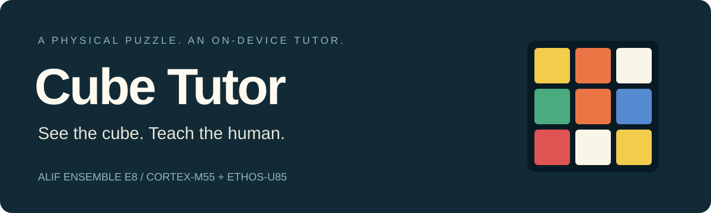

<p align="center">
  
</p>

<p align="center">
  <b>Alif Ensemble E8 · Arm Cortex-M55 + Ethos-U85 · No cloud inference</b><br />
  <a href="#the-live-loop">How it works</a> ·
  <a href="#models--compute">Models</a> ·
  <a href="#get-started">Get started</a> ·
  <a href="docs/cube-tutor-status.md">Build & validation notes</a>
</p>

A camera-grounded Rubik's Cube tutor. Hold up a scrambled cube: the board
finds its faces, reads the stickers and gives feedback on its own display.
**You do not need to solve the cube before using it.**

Built at the Arm + ExecuTorch hackathon in October 2026. The camera,
neural inference, colour reading and interface all run on the board;
the laptop is for training, flashing and diagnostics.

## The live loop

| See | Locate | Read | Guide |
| --- | --- | --- | --- |
| OV5675 camera and mirrored landscape preview | YOLOv8 cube-face boxes on the Ethos-U85 | Calibrated nine-sticker colour reading on the Cortex-M55 | LVGL labels, remembered faces and white-cross feedback |

The display stays simple: live video, bounding boxes and colour letters.
A face is remembered after **three identical complete reads**, reducing
single-frame flicker. The newest firmware adds a rudimentary white-cross
planner after all six faces have been recorded. It suggests a face and turn
direction; it does not require a solved starting state.

## Models & compute

| Component | Size / interface | Where it runs |
| --- | --- | --- |
| YOLOv8n-style cube-face detector | **3,138,003 parameters**; **2.89 MiB** Vela-compiled model; 192×192 RGB | INT8 neural graph on **Ethos-U85-256**, invoked by **TensorFlow Lite Micro** |
| Sticker colour reader | C code; robust patch samples, saved white balance and HSV rules | **Cortex-M55 CPU** |
| Face memory, cross planner and UI | C/C++, no additional neural model | **Cortex-M55 CPU** |

The detector exposes float32 input `[1,3,192,192]` and output `[1,5,756]`.
Its compiled graph is `QUANTIZE → ethos-u → DEQUANTIZE`: boundary conversions,
camera preprocessing, box decoding and suppression remain on the CPU.
Vela reports **771.5 KiB model SRAM**, not total application RAM.

We also exercised a separate **14.14 KiB ExecuTorch sticker-centroid prototype**
with two Ethos-U partitions. It is not the final colour reader; this demo's
detector uses TFLM. [Exact artifacts and runtime boundaries →](docs/cube-tutor-status.md#model-artifacts)

## Making the stickers readable

Camera white balance and the cube's glossy stickers made raw colour thresholds
unreliable. The shipped reader samples multiple patches per cell, applies the
named **table calibration**, then uses HSV bands and confidence rejection.
The fix is calibrated colour rules—not a learned centroid model.

The table profile loads at startup. Any application joystick button can enter
calibration and request a validated lock; a new button-triggered profile is
runtime-only. Reboot restores the saved table profile.

## Get started

This is a **source release**. Custom detector weights and flashable firmware
are not bundled; the inherited human-face model is not a substitute.

```sh
git clone https://github.com/cosmicz/alif-cube-tutor.git
cd alif-cube-tutor

# Pure C/C++ Cube Tutor tests: no board, weights or submodules needed.
bash tests/run_cube_tests.sh

# Optional AddressSanitizer + UndefinedBehaviorSanitizer run.
SANITIZE=1 bash tests/run_cube_tests.sh
```

For firmware development, start with the [MLEK setup guide](ML_Embedded_Evaluation_Kit.md)
and [Cube Tutor build notes](docs/cube-tutor-status.md#building-for-the-board).
The demo configuration uses **AppKit E8, OV5675, UART4, 90° display rotation,
Ethos-U85-256 and LVGL software rendering**.

## Find your way around

| Start here | Responsibility |
| --- | --- |
| [UseCaseHandler.cc](source/app/use_case/alif_object_detection/src/UseCaseHandler.cc) | Camera → detector → colours → display loop |
| [CubeFaceMultiSelect.hpp](source/app/use_case/alif_object_detection/include/CubeFaceMultiSelect.hpp) | Face selection and duplicate suppression |
| [cube_preview.h](source/hal/source/components/camera/source/alif/source/cube_preview.h) | Sampling, white balance, HSV classification and rejection |
| [hal_camera_alif.c](source/hal/source/components/camera/source/alif/source/hal_camera_alif.c) | Camera mapping and startup table calibration |
| [cube_face_memory.h](source/app/use_case/alif_object_detection/include/cube_face_memory.h) | Stable reads and remembered faces |
| [cube_cross_planner.h](source/app/use_case/alif_object_detection/include/cube_cross_planner.h) | Bounded white-cross next-move search |
| [tests/](tests/) | Host regressions and framework tests |

## What we learned—and what's next

Display rotation and camera rotation are different transforms. A good detector
cannot compensate for bad colour calibration. On this board, preserving boot
metadata and keeping graphics work outside long inference locks mattered as
much as model conversion.

Next: detect four corners of each face for perspective-correct sampling,
validate the assembled six-face state, and visually verify each suggested move.
The prototype's lighting assumptions, remaining red/orange ambiguity and
on-board validation status are recorded in the [handoff notes](docs/cube-tutor-status.md).

## Credits & licence

Built on [npow/alif-mlek-yolo](https://github.com/npow/alif-mlek-yolo) and the
Arm/Alif ML Embedded Evaluation Kit, using PyTorch, Ultralytics, Arm Vela,
TensorFlow Lite Micro and LVGL. Upstream history and notices are preserved.
See [License.txt](License.txt), [Apache 2.0](LICENSE_APACHE_2.0.txt), and
dependency-specific terms.

[Hackathon submission: Arm-Examples/CMSIS-Executorch #37](https://github.com/Arm-Examples/CMSIS-Executorch/pull/37)
